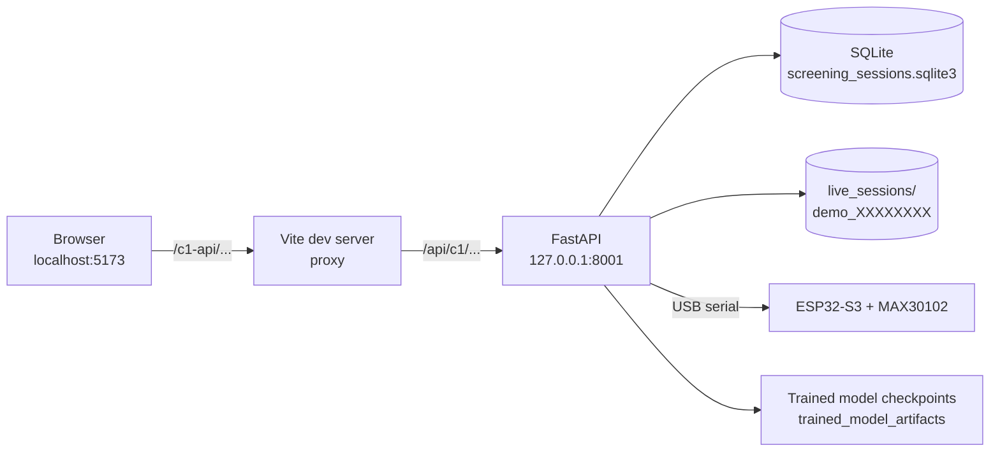

# AyurAI Component 1: Reliability-Aware Multimodal Anaemia Screening

Research prototype for the AyurAI project (SLIIT, 4th-year research). Component 1 collects
consented screening evidence (questionnaire, webcam photographs and finger PPG) for a coded test
participant, checks the technical quality of each input, runs existing trained image models, and
combines the evidence with a rule-based, reliability-weighted fusion step into an **experimental**
screening tier for clinician review.

> **Research prototype: not a diagnostic device.** Outputs are unvalidated screening evidence
> for clinician review only. The reliability score is a heuristic, not a probability. Confirm
> anaemia with a laboratory haemoglobin test. Only coded fictional/test sessions (`demo_XXXXXXXX`)
> are supported; do not enter names or other identifiers.

---

## 1. Overview

### Implemented features (PP1)

| Feature | What it does |
|---|---|
| Consent and patient profile | Overall consent plus separate image and PPG consent; guardian permission under 18. Age, patient-reported sex and pregnancy status are validated (sex is required from age 15; "male" cannot be combined with "pregnant"). |
| Adaptive questionnaire | Common symptom and immediate-safety questions, then up to 10 rule-selected follow-up questions (`question_bank_v1.json`), medications and allergies. |
| Safety referral | An urgent "yes" (SAF01–SAF04, or PR06 in pregnancy) or an unresolved safety answer stops routine screening and saves a referral-only record (no images, PPG or risk tier). |
| Webcam capture | Conjunctiva, nail-bed and tongue photographs from the browser. Each photo is reviewed before saving; the gallery supports delete and retake. Images are re-encoded as PNG (metadata stripped). |
| PPG capture | RED/IR samples from an ESP32-S3 + MAX30102 over local USB serial, run as a background job with live progress and cancel; a finger-comfort check is required first. |
| Quality checks | Image technical checks (resolution, brightness, blur, contrast, dark/overexposed area) and PPG 5-second window checks. |
| Image models | Existing trained models (no live training): conjunctiva and nail-bed classifiers, a nail-bed Hb regression model and an exploratory tongue Hb model. |
| Reliability-aware fusion | Evidence is weighted by technical pass ratio × held-out model performance, with an equal-weight majority vote reported as a conventional baseline. |
| Clinician report | Risk tier, evidence checklist, rationale, safety flags and limitations; marked outdated when images change after analysis. |
| Session storage | SQLite database plus one folder per session; sessions can be resumed and reviewed in Screening records. |
| Component 2 payload | JSON shaped for Component 2's provisional `C1ScreeningPayload` contract (not produced for safety-referral sessions). |

### Current research limitations
Summary only; see [section 11](#11-research-limitations).
- Fusion is rule-based, not a learned multimodal model.
- The reliability score is not calibrated.
- There is no automatic eye or nail region-of-interest (ROI) detection.
- PPG and tongue Hb models are not used in fusion because they did worse than a simple baseline.
- No clinical validation has been done on paired data.

---

## 2. Technology stack

| Layer | Technology (as used in this repository) |
|---|---|
| Backend API | Python 3.13, FastAPI, Uvicorn (`component1/api/`) |
| Frontend | Shared AyurAI client: React 19, TypeScript, Vite 8, Tailwind CSS 4 (`ayurai-client/`) |
| Storage | SQLite (`screening_sessions.sqlite3`) + per-session folders (`live_sessions/demo_XXXXXXXX/`) |
| PPG hardware | ESP32-S3 + MAX30102 over USB serial (115200 baud); firmware in `arduino/ayurai_max30102_local/` |
| Serial | pyserial |
| Image processing | OpenCV (decode/encode, technical quality checks), Pillow |
| Image models | PyTorch / torchvision: ResNet-50 classifiers and EfficientNet-B0 classification/regression models |
| Signal processing | NumPy, SciPy (Butterworth band-pass), pandas, Matplotlib (saved plots) |
| Fusion | Pure Python rules in `component1/fusion/reliability_fusion.py` |

No cloud services are used: no Firebase, Wi-Fi, MQTT or Bluetooth. Everything runs on `127.0.0.1`.



---

## 3. Prerequisites

| Requirement | Details |
|---|---|
| Windows 10/11 | Commands below are for PowerShell. |
| Python 3.13 | Developed with Python 3.13.7 (64-bit). The `py` launcher is used below. |
| Node.js + npm | Developed with Node.js 24.14.0 and npm 11.9.0 (no `engines` field is set in `package.json`). |
| Python packages | Pinned in `component1/requirements.txt` (NumPy, pandas, SciPy, OpenCV, scikit-learn, Matplotlib, PyTorch, torchvision, Pillow, joblib, FastAPI, Uvicorn, Streamlit, pyserial). **CPU is the default.** A CUDA GPU is used automatically only if a CUDA-enabled PyTorch build and a compatible NVIDIA GPU/driver are present (optional; see section 5). |
| Frontend packages | From `ayurai-client/package-lock.json` (`npm ci`). Vite 8 and `@vitejs/plugin-react` need Node `^20.19.0 \|\| >=22.12.0`; ESLint 10 needs `^20.19.0 \|\| ^22.13.0 \|\| >=24`. |
| Webcam | Any webcam the browser can access. |
| Trained model checkpoints | Required for image analysis; **not stored in Git** (see below). |
| PPG hardware (optional) | ESP32-S3 board + MAX30102 module and a USB **data** cable. The development board enumerates as `USB Serial Device (COMx)` (Espressif USB ID `303A:1001`), which uses the built-in Windows USB serial driver. A board that uses a USB-to-UART bridge chip needs that chip's driver instead. |
| Arduino IDE (firmware only) | ESP32 board support plus the SparkFun MAX3010x library (`MAX30105.h`, `spo2_algorithm.h`). |

### Data folder outside the repository
All runtime data lives in a `datasets` folder **next to** the repository folder:

```
<parent folder>\
├── AyurAI-RP\              (this repository)
└── datasets\
    ├── screening_sessions.sqlite3        (created automatically)
    ├── live_sessions\demo_XXXXXXXX\      (created automatically)
    └── trained_model_artifacts\          (must be copied in manually; see "Model checkpoints" below)
```

### Model checkpoints (required, not in Git)

Image analysis loads five PyTorch checkpoints from `..\datasets\trained_model_artifacts\`. The paths are fixed in code (there is no environment variable for them):
- [`models/images/unified_image_inference.py`](models/images/unified_image_inference.py) (`WEIGHT_ROOT`, `CHECKPOINTS`) for the conjunctiva and nail-bed models.
- [`models/images/predict_tongue_hb.py`](models/images/predict_tongue_hb.py) (`MODEL_PATH`) for the tongue model.

Do not commit the checkpoints to Git: they total about 238 MB.

| Path under `trained_model_artifacts\` | Model (source key) | Used in fusion | Size (bytes) | SHA-256 (reference copy) |
|---|---|---|---|---|
| `efficientnet_b0_best.pth` | CP-AnemiC conjunctiva classifier, EfficientNet-B0 (`cp_anemic_v2`) | no (weight 0) | 16,343,621 | `1a0ef053180fa5017b37174d1282803133497ee99ebb176f03ee059d8cd21809` |
| `ghana_conjunctiva\resnet_50_best.pth` | Ghana conjunctiva classifier, ResNet-50 (`ghana_conjunctiva`) | yes (0.28) | 94,368,809 | `6dc6cd9de966011249ac665e8956b43bcdc19f9042c566601a5bf8915fffd127` |
| `ghana_fingernail\resnet_50_best.pth` | Ghana fingernail classifier, ResNet-50 (`ghana_fingernail`) | yes (0.21) | 94,368,809 | `bdfec634b1d0bbc3fce68a52aebcbf99b6cba1f4d728505eaba36e31d9c6e41a` |
| `yakimov_hb_2024\efficientnet_b0_best.pth` | Yakimov nail-bed Hb regression, EfficientNet-B0 (`yakimov_hb_2024`) | yes (0.066) | 16,338,757 | `c16e5d4fb734693e05b8ccf04709ece80fccfaf47112633bc96baab6f8023207` |
| `imagehb_tongue\efficientnet_b0_best.pth` | ImageHB tongue Hb regression, EfficientNet-B0 (`imagehb_sample`) | no (weight 0) | 16,338,821 | `edd0d6cbc3c27ef67ebb70365698c274d652059a1bd26d7d7c09ecd120b94aae` |

The reference hashes were recorded from the development machine's working copies on 2026-10-21. Hashes identify the files only; they reveal nothing about the training data.

**Where the checkpoints come from:**

| Checkpoint | Produced by (script in this repository) | Original dataset / checkpoint download |
|---|---|---|
| CP-AnemiC classifier | **Not found.** No script in the repository (or its Git history) writes this root-level path. | Source not yet documented |
| Ghana conjunctiva / fingernail | [`models/images/train_catalog_models.py`](models/images/train_catalog_models.py) `--source ghana_conjunctiva` or `--source ghana_fingernail`. Writes `trained_model_artifacts\<source>\resnet_50_best.pth`; needs the local image catalog (`ayurai_image_catalog.sqlite3`) and splits. | Source not yet documented |
| Yakimov nail-bed Hb | [`models/images/train_yakimov_hb_models.py`](models/images/train_yakimov_hb_models.py) `--model efficientnet_b0`. Writes `trained_model_artifacts\yakimov_hb_2024\efficientnet_b0_best.pth`. | Source not yet documented |
| ImageHB tongue Hb | [`models/images/train_tongue_hb.py`](models/images/train_tongue_hb.py). Writes `trained_model_artifacts\imagehb_tongue\efficientnet_b0_best.pth`. | Source not yet documented |

Retraining is not the setup route: it needs the original datasets, and it would produce different weights (different hashes and results). Copy the reference checkpoints instead.

**Verify the checkpoints** (PowerShell, from the repository root):

```powershell
$root = "..\datasets\trained_model_artifacts"
"efficientnet_b0_best.pth","ghana_conjunctiva\resnet_50_best.pth","ghana_fingernail\resnet_50_best.pth",
"yakimov_hb_2024\efficientnet_b0_best.pth","imagehb_tongue\efficientnet_b0_best.pth" | ForEach-Object {
  $p = Join-Path $root $_
  if (Test-Path $p) { "{0}  {1}" -f (Get-FileHash $p -Algorithm SHA256).Hash.ToLower(), $_ } else { "MISSING  $_" }
}
```
Compare the output with the SHA-256 column above.

**If a checkpoint is missing:**
- A missing conjunctiva or nail-bed checkpoint is reported as `checkpoint_missing`, and fusion will usually return **Insufficient evidence**.
- A missing tongue checkpoint makes **Analyse** fail with "Image analysis failed" for any session that has tongue photos.

**Still needed from the project team to make setup reproducible:**
- [ ] Where the five reference checkpoints are stored for the team (for example a shared drive or release asset), and who can grant access.
- [ ] The script, command and data used to produce the root-level CP-AnemiC `efficientnet_b0_best.pth`.
- [ ] For each dataset (CP-AnemiC, Ghana conjunctiva, Ghana fingernails, Yakimov Hb 2024, ImageHB): the citation, download location and licence or terms of use.
- [ ] The exact training commands (epochs and seeds) used for the reference checkpoints, if retraining is ever required.

---

## 4. Project structure

```
AyurAI-RP\
├── component1\
│   ├── api\
│   │   ├── server.py         FastAPI app (entry point): health, sessions, reports, re-run fusion, C2 payload
│   │   └── intake.py         Intake routes: session creation, questionnaire, referral, images, PPG jobs, analysis
│   ├── acquisition\
│   │   ├── questionnaire\    question_bank_v1.json, questionnaire_engine.py, questionnaire_assistant_app.py (rules reused by the API; legacy Streamlit UI)
│   │   ├── ppg\              capture_live_ppg.py (serial reader), register_session_ppg.py, register_session_vitals.py
│   │   └── images\           capture_webcam.py (legacy CLI capture), dataset import/audit scripts
│   ├── quality\
│   │   ├── images\assess_webcam_quality.py   image technical checks -> quality_report.json
│   │   └── ppg\assess_live_ppg.py            PPG window checks
│   ├── preprocessing\ppg\filter_ppg.py       band-pass filtering
│   ├── models\images\        unified_image_inference.py, evaluate_webcam_session.py, predict_tongue_hb.py, training/evaluation scripts
│   ├── models\ppg\           PPG Hb training/evaluation (research; not applied live)
│   ├── fusion\
│   │   ├── reliability_fusion.py       weights, WHO Hb cut-offs, tiers, conventional baseline
│   │   └── fuse_screening_session.py   loads session evidence -> fusion_report.json
│   ├── evaluation\, experiments\      research metrics, figures and experiment scripts
│   ├── tests\                test_intake_workflow.py, test_reliability_fusion.py, test_c2_payload.py
│   ├── requirements.txt, .env.example
├── ayurai-client\            shared React frontend (Component 1 UI in src\features\screening\)
│   ├── src\features\screening\Component1IntakeWizard.tsx   6-step intake wizard (New screening page)
│   ├── src\features\screening\Component1SessionPanel.tsx   clinician report / Screening records
│   └── src\lib\api\component1.ts                           Component 1 API client
└── arduino\ayurai_max30102_local\    current ESP32 firmware (USB serial). arduino\sketch_aug25a is deprecated.
```

**Session folder contents** (`datasets\live_sessions\demo_XXXXXXXX\`):
- `manifest.json` lists the active captures. Removed or replaced captures are listed in `removed_captures`.
- `images\<modality>\` holds the saved photos. Deleted or replaced photos are moved to `images\_removed\` and kept for audit.
- `ppg\` holds the RED/IR and metrics CSV files plus quality output.
- `quality_report.json`, `image_model_results.json` and `fusion_report.json` are written by analysis.
- `screening_report.json`, `screening_result.json` and `c2_payload.json` are the saved record. Referral sessions get `safety_referral.json` and no C2 payload.
- `_superseded\` keeps older results that are no longer current.

SQLite tables used: `questionnaire_responses`, `ppg_live_recordings`, `ppg_live_vitals`.

---

## 5. Installation and setup (Windows PowerShell)

Run from the repository root (quote the path; it may contain spaces or apostrophes):

```powershell
cd "<path-to>\AyurAI-RP"

# 1. Python virtual environment for Component 1
py -3.13 -m venv component1\.venv
component1\.venv\Scripts\python.exe -m pip install --upgrade pip
component1\.venv\Scripts\python.exe -m pip install -r component1\requirements.txt

# 2. Component 1 configuration (serial port and baud rate only; no secrets)
Copy-Item component1\.env.example component1\.env
# Edit component1\.env if your ESP32 is not on COM11 (see section 7)

# 3. Frontend dependencies
cd ayurai-client
npm ci
cd ..
```

`component1\.env` (ignored by Git):

```
C1_SERIAL_PORT=COM11
C1_SERIAL_BAUD=115200
```

**Frontend sign-in for local development.** The screening pages sit behind the shared AyurAI sign-in, which is Component 4. To run Component 1 without Component 4, create `ayurai-client\.env.local` containing:

```
VITE_AUTH_BYPASS=true
```

This only works in the Vite dev server, and the app shows a "Sign-in bypassed (development only)" banner. Its other defaults are already correct for Component 1: `VITE_C1_API_BASE_URL=/c1-api` and `C1_PROXY_TARGET=http://127.0.0.1:8001` (see `ayurai-client\.env.example`).

Also copy the model checkpoints into `..\datasets\trained_model_artifacts\` and verify their hashes ([section 3](#model-checkpoints-required-not-in-git)).

### Notes on installation
- **Calling the venv's Python directly.** The commands use `component1\.venv\Scripts\python.exe` without activating the venv. This avoids PowerShell execution-policy errors from `Activate.ps1`.
- **Quote the repository path.** Paths with spaces or apostrophes must be in double quotes.
- **PyTorch builds.** `pip install -r component1\requirements.txt` installs the standard PyPI wheels: `torch==2.11.0` and `torchvision==0.26.0`, which run on CPU. That is the default and is enough for PP1.
  - GPU acceleration is optional. It needs a compatible NVIDIA GPU and driver plus a CUDA-enabled build of the **same** torch/torchvision versions, installed from the PyTorch installation selector (pytorch.org).
  - The development machine uses such a build (`2.11.0+cu130`). The code picks CUDA if available, otherwise CPU, with no configuration needed.
- **Unpinned sub-dependencies.** `requirements.txt` pins only the 14 direct packages. Their dependencies (63 packages in total) are resolved at install time, so a later install can pick newer versions. For an exact copy of a working environment, the team would need to add a constraints file from `pip freeze`.
- **Path length.** If pip fails on a very long folder path (a Windows path-length error), move the repository to a shorter path or enable Windows long-path support.
- **`npm ci` deletes `node_modules`.** It removes the existing folder and reinstalls exactly what is in `package-lock.json`, so don't run it on the demo machine just before a demo.

### Installation verification status

| Check | Status |
|---|---|
| All 14 pinned packages resolve to prebuilt Python 3.13 / Windows x64 wheels, so no compiler is needed. Checked with `pip install --dry-run --ignore-installed --only-binary=:all: --python-version 3.13 --platform win_amd64 -r component1\requirements.txt`. | Verified (dry-run, 2026-10-21) |
| The working venv satisfies every pin (torch and torchvision are the `+cu130` builds) and `pip check` reports no broken requirements. | Verified |
| `package-lock.json` (lockfileVersion 3) matches `package.json`, and `npm ls --all` reports no problems. | Verified |
| Full install on a fresh Windows machine (new venv, `pip install`, `npm ci`, first start) | **NOT TESTED** |

**Fresh-machine checklist** (tick each item when you test on a clean PC):
- [ ] `py -3.13 --version` prints Python 3.13.x (64-bit); `node --version` meets the Node requirement in section 3.
- [ ] The venv is created, and `pip install -r component1\requirements.txt` finishes without errors.
- [ ] `component1\.venv\Scripts\python.exe -m pip check` reports "No broken requirements found."
- [ ] `component1\.venv\Scripts\python.exe -c "import torch, torchvision, cv2, fastapi, serial; print(torch.__version__, torch.cuda.is_available())"` runs (`False` is fine on CPU).
- [ ] `npm ci` in `ayurai-client` finishes without errors.
- [ ] `component1\.env` and `ayurai-client\.env.local` are created as above.
- [ ] The five checkpoints are present and their SHA-256 values match.
- [ ] The backend tests, `npm run typecheck` and `npm run lint` pass ([section 9](#9-testing)).
- [ ] The API health check returns `status: ok` directly and through the Vite proxy.
- [ ] One full screening runs end to end, with a webcam photo and (if hardware is available) one PPG recording.

---

## 6. Starting the application

> **Official PP1 demonstration:** the FastAPI backend below (`component1.api.server`, port 8001) together with the shared React client `ayurai-client` (port 5173). Do not use the Streamlit apps, the old command-line capture scripts, `ayurai-backend` or the removed `Stimulation_dashboard` for the demo ([section 12](#12-legacy-and-optional-tools)).

Use **two PowerShell windows**, both started from the repository root. Keep **both running** while you use the app.

**Terminal 1: backend API (port 8001)**
```powershell
cd "<path-to>\AyurAI-RP"
component1\.venv\Scripts\python.exe -m uvicorn component1.api.server:app --host 127.0.0.1 --port 8001
```
Wait for `Application startup complete.` Run it without `--reload`, and restart it after any backend code change.

**Terminal 2: frontend (port 5173)**
```powershell
cd "<path-to>\AyurAI-RP\ayurai-client"
npm run dev
```
Open **http://localhost:5173/screening/new** to start a new screening, or **http://localhost:5173/screenings** to see Screening records.

**How the browser reaches the API:**
1. The frontend calls `/c1-api/...` on its own origin.
2. The Vite dev server (`ayurai-client\vite.config.ts`) removes the `/c1-api` prefix and forwards the request to `http://127.0.0.1:8001`. For example, `/c1-api/api/c1/health` becomes `http://127.0.0.1:8001/api/c1/health`.
3. Because of this, the API needs no CORS settings and only listens on localhost.
4. To point the frontend at a different backend, set `C1_PROXY_TARGET` in `ayurai-client\.env.local`.

---

## 7. ESP32 / MAX30102 configuration

**Current firmware:** [`arduino/ayurai_max30102_local/ayurai_max30102_local.ino`](../arduino/ayurai_max30102_local/ayurai_max30102_local.ino) (local USB serial only; no Wi-Fi or cloud). `arduino/sketch_aug25a/` is deprecated and is not used.

### Hardware configuration (verified from the firmware and the connected board)

| Item | Value | Source |
|---|---|---|
| Board family | ESP32-S3 (the firmware header says "ESP32-S3 Mini") | firmware comment |
| USB connection | Enumerates as `USB Serial Device (COM11)`, USB ID `303A:1001` (Espressif native USB) | `python -m serial.tools.list_ports -v` on the development PC |
| Serial baud rate | 115200 (`SERIAL_BAUD`); must match `C1_SERIAL_BAUD` | firmware, `component1\.env` |
| I2C pins | SDA = GPIO 8, SCL = GPIO 9 (`SDA_PIN`, `SCL_PIN`); bus at 100 kHz | firmware |
| Sensor library | `MAX30105.h` and `spo2_algorithm.h` (SparkFun MAX3010x sensor library) | firmware `#include`s |
| MAX30102 settings | LED brightness `0x1F`, sample average 4, RED + IR mode, sample rate 100, pulse width 411, ADC range 4096 | firmware |
| Output sample rate | About **25 samples/s** (100 Hz with 4-sample averaging); a 20 s recording has about 500 samples | firmware comment, saved recordings |
| Finger detection | IR ≥ 10000 (preliminary heuristic, not validated) | firmware |
| HR / SpO2 | Maxim algorithm over a 100-sample buffer, recalculated about once per second; implausible values (HR outside 40–180, SpO2 outside 70–100) are sent as `null` | firmware |
| Temperature | DS18B20 disabled (`ENABLE_DS18B20 0`), so it is always `null` and shown as **N/A** | firmware |

**Serial protocol** (what the API expects):
- At startup the firmware prints `#AYURAI_MAX30102_LOCAL_READY`, then `#METRICS_FORMAT,time_ms,hr_bpm,spo2_percent,temp_c,finger_present`, then the header `time_ms,red,ir`.
- Each sample is `time_ms,red,ir`.
- About once per second it prints `#METRICS,time_ms,hr_bpm,spo2_percent,temp_c,finger_present`.
- If the sensor is not detected, it prints `#ERROR,MAX30102_NOT_FOUND` and stops sending samples. The app then reports "no valid RED/IR rows".

### Hardware settings to confirm
The repository does **not** record these, so confirm them on the real setup and write them here:
- [ ] Exact ESP32-S3 board or module (manufacturer and model) and the board selected under Arduino IDE **Tools → Board**.
- [ ] Arduino IDE **Tools** menu USB settings used when flashing (for example **USB CDC On Boot** and **USB Mode**). Serial output currently arrives on the native USB port (`303A:1001`), so the flashed build works, but the menu values are not recorded.
- [ ] Version of the ESP32 board package (Boards Manager) and of the SparkFun MAX3010x library (Library Manager).
- [ ] MAX30102 module type and supply voltage. Check the module's markings or datasheet; do not assume. The deprecated `sketch_aug25a` notes "VCC → 3.3V", but this has not been confirmed for the current hardware.
- [ ] Wiring of VIN/VCC and GND (SDA and SCL are GPIO 8 and 9, as above).

**How to check in Arduino IDE without changing the board:**
1. Open the firmware `.ino` and look at **Tools**. The selected board and the USB settings are listed there.
2. Note the versions shown in **Boards Manager** (esp32) and **Library Manager** (SparkFun MAX3010x).
3. Do **not** press Upload. Close Arduino IDE (including Serial Monitor) before using the app, because only one program can open the COM port.

**Check the running firmware non-invasively:** in the app, **PPG sensor → Test live signal (4 s, not saved)** confirms that valid rows arrive, and shows the rows-per-second rate (about 25 is expected).

**Connection:** use a USB **data** cable; charge-only cables do not create a COM port.

**Find the COM port** (any of these):
```powershell
# List serial ports with descriptions and USB IDs
component1\.venv\Scripts\python.exe -m serial.tools.list_ports -v

# Ask the running API (also shows the configured port)
Invoke-RestMethod http://127.0.0.1:8001/api/c1/hardware/serial-ports
```
You can also check Device Manager under **Ports (COM & LPT)**. Set the port in `component1\.env` (`C1_SERIAL_PORT=COMx`), then restart the API. In the app, **PPG sensor → Check port** shows the configured port and whether Windows lists it. **Test live signal (4 s, not saved)** checks that valid RED/IR rows actually arrive.

**Common connection errors** (as reported by the app):

| Message | Cause / fix |
|---|---|
| `COMx is not available…` | Board unplugged, charge-only cable or wrong port in `component1\.env`. |
| `COMx is in use by another program…` | Close Arduino Serial Monitor, the legacy Streamlit Live PPG page or any other serial tool. Only one program can open the port. |
| `…opened but no valid RED/IR rows arrived…` | Wrong firmware or baud rate, or the MAX30102 is not detected (the firmware then prints `#ERROR,MAX30102_NOT_FOUND` and sends no samples). Check the I2C wiring (GPIO 8/9) and power. The ESP32 restarts when the port opens; the app waits 2 s before reading. |
| `The PPG sensor is already in use by another recording or check` | A recording or live-signal check is already running. Wait or press **Cancel (nothing saved)**. |

---

## 8. PP1 demonstration workflow

Open **New screening** and follow the six steps of the AyurAI Clinical Screening wizard:

1. **Session.** Choose **Start new screening session** to create a coded `demo_XXXXXXXX` session, or resume an unfinished one.
2. **Patient & consent.**
   - Enter age, sex (patient-reported) and pregnancy status. Invalid or incomplete combinations are explained on the page and block **Next**.
   - Record consent, plus separate image and PPG consent. Guardian permission is required under 18.
3. **Questionnaire.**
   - Answer the immediate-safety and common symptom questions. An urgent or unresolved safety answer offers **Stop and refer to clinician**, which saves a referral-only record.
   - Load the adaptive follow-up questions.
   - Record medications and allergies, then save.
4. **Webcam.**
   - Choose **Start preview**, pick Conjunctiva, Nail beds or Tongue, then **Capture**. Review the photo (and correct its category if needed) before **Save photo**.
   - The counters and the saved-photo gallery come from the server.
   - Use ✕ to remove a photo (with confirmation), or **Retake** to replace one. The original is retired only after the replacement has been saved.
5. **PPG sensor.**
   - Complete the finger-comfort check.
   - Optionally use **Check port** and **Test live signal**.
   - Choose a duration and **Record PPG**. Progress shows the samples received, finger presence and the device's HR/SpO2. The result shows sample count, receive rate and technical-quality reasons. **Record another (retake)** keeps earlier recordings.
6. **Report.**
   - Choose **Analyse and generate clinician report**. This runs the image quality checks and image models, then fusion, and saves the record.
   - The report shows the experimental tier (Low / Moderate / High / Insufficient Evidence), the heuristic reliability score, the evidence checklist, weighted evidence, the conventional baseline and limitations.

**Saved sessions.**
- On **Screening records**, choose **Connect / refresh** to list the saved sessions, newest first, with their status.
- **Load screening evidence** opens a session's report.
- **Re-run fusion** recomputes fusion on existing evidence. If photos changed, it re-runs the image models first.
- If photos changed after analysis, the report is marked **"Images changed — re-run analysis"** and downloads are disabled until it is re-run.

**Component 2 payload.**
- **Component 2 payload** downloads JSON in Component 2's provisional `C1ScreeningPayload` format. The same file is saved as `c2_payload.json` in the session folder.
- **C1 screening JSON** downloads the standalone Component 1 result.
- Safety-referral sessions have no Component 2 payload.

### How the tier is decided (current rules)
- Each model output is weighted by **technical pass ratio × held-out performance weight**:

  | Model | Weight |
  |---|---|
  | Ghana conjunctiva | 0.28 |
  | Ghana fingernail | 0.21 |
  | Yakimov nail Hb | 0.066 |
  | CP-AnemiC | 0 |
  | Tongue Hb | 0 |
  | PPG Hb | 0 |
  | Questionnaire symptoms | 0.10 (needs at least 3 answered symptom items) |

- Hb estimates are compared with the WHO 2011 cut-off for the patient's age, sex and pregnancy status.
- The result is **Insufficient evidence** if any of these apply:
  - total reliability is below 0.40;
  - fewer than two physiological modalities are usable;
  - weighted conflict is above 0.35.
- Otherwise the weighted score sets the tier: **High** at 0.40 or above, **Moderate** at 0.10 or above, **Low** below that.
- The maximum reachable reliability is 0.656.

---

## 9. Testing

All commands run from the repository root unless noted.

**Backend tests** (43 tests, about 45 s):
```powershell
component1\.venv\Scripts\python.exe -m unittest component1.tests.test_intake_workflow component1.tests.test_reliability_fusion component1.tests.test_c2_payload
```
- The workflow tests redirect every data path to a temporary folder and use a simulated ESP32 and synthetic images, so your real `datasets` folder is never written.
- `RealBaselineReadOnly` only reads session `demo_e37082b4`, and is skipped if that session isn't present.
- The Component 2 contract test is skipped if `component2` can't be imported.
- Add `-v` to list each test.

**Frontend typecheck and lint** (from `ayurai-client\`):
```powershell
npm run typecheck
npm run lint
```
- `npm run typecheck` runs `tsc -b --noEmit`. This builds the referenced projects `tsconfig.app.json` (all of `src`) and `tsconfig.node.json` (`vite.config.ts`).
  - Before 2026-10-21 the script was `tsc --noEmit`, which checked no source files, because the root `tsconfig.json` has `"files": []` and only project references.
- `npm run lint` runs ESLint on the whole client.

**API health check** (with the backend running):
```powershell
Invoke-RestMethod http://127.0.0.1:8001/api/c1/health
# Through the Vite proxy (frontend also running):
Invoke-RestMethod http://localhost:5173/c1-api/api/c1/health
```
The expected response is `service: ayurai-component1`, `status: ok` and `demo_only: True`. The interactive API docs are at http://127.0.0.1:8001/docs.

**Manual hardware checks** (they create a real session in `datasets`; use a test participant):
1. **Webcam:**
   - Start preview, capture and save one photo of each type.
   - Check that the counters and gallery update.
   - Remove one photo and retake another, and check that the counters stay correct.
2. **PPG:**
   - **Check port** shows the port as listed.
   - **Test live signal** reports valid rows per second.
   - A 20 s **Record PPG** ends in "Recording saved" with technical-quality reasons.
   - **Cancel** saves nothing.
   - Unplugging the USB cable shows the "not available" message.
3. **Report:** Analyse, then confirm the report loads in **Screening records**.

---

## 10. Troubleshooting

| Problem | What to do |
|---|---|
| **Port 8001 already in use** | Find the process: `Get-NetTCPConnection -LocalPort 8001 -State Listen \| Select-Object OwningProcess`. Check it with `Get-CimInstance Win32_Process -Filter "ProcessId=<id>" \| Select-Object CommandLine`. If it is an old Component 1 API, stop it with `Stop-Process -Id <id>` and start the API again. An old API still running is the usual reason new routes return **405** or **404**. |
| **Port 5173 already in use** | Vite automatically uses the next free port (for example 5174) and prints the URL; use that URL. To free 5173, stop the old `npm run dev` window (Ctrl+C) or find the process as above. |
| **Webcam permission errors** | Open the app via `http://localhost:5173` (camera access needs `localhost` or HTTPS). Allow camera access in the browser's site settings and in Windows **Settings → Privacy & security → Camera**. Close other apps using the camera (Teams, Zoom, Camera app). |
| **ESP32 serial port errors** | See the table in [section 7](#7-esp32--max30102-configuration). Check `C1_SERIAL_PORT` in `component1\.env` and restart the API after changing it. |
| **Image gallery not loading / thumbnails missing** | The backend is probably an old process. `GET /c1-api/api/c1/sessions/<id>/images` must return 200; restart the API as above. Images are listed from `manifest.json`, so a manually deleted file shows as unavailable. |
| **"Component 1 local API could not be reached"** | The backend is not running on 8001, or the frontend was not started with `npm run dev`. Run both health checks in [section 9](#9-testing). |
| **Screening pages redirect to sign-in** | Set `VITE_AUTH_BYPASS=true` in `ayurai-client\.env.local` and restart `npm run dev` (development only). |
| **Re-run fusion is slow or times out** | Re-run fusion allows up to 120 s, and analysis up to 300 s. When photos changed, the image models run again (slower on CPU). A browser timeout doesn't stop the backend: wait, then use **Load screening evidence**. |
| **Every result is "Insufficient evidence"** | Check the evidence checklist. Common causes are photos failing the technical checks (dark, blurred or low contrast), missing conjunctiva or nail-bed photos, or missing model checkpoints. |

---

## 11. Research limitations

- **Rule-based fusion.** Fusion is a hand-specified reliability-weighted mean whose weights come from held-out metrics on public datasets. The learned multimodal (CNN-based) fusion described in the proposal is future work.
- **Uncalibrated reliability score.** The reliability score is a heuristic and is not a probability (`reliability_score_is_probability: false`). No calibration has been done yet (for example temperature scaling, ECE or Brier score). The Component 2 payload sends `screening_confidence: null`.
- **No automatic ROI detection.** Whole webcam frames are passed to the models; eye and nail ROI detection is not implemented.
- **Weak or excluded models.**
  - The CP-AnemiC conjunctiva model (AUROC 0.474), the tongue Hb model and the PPG Hb model are not used in fusion (weight 0), because each did worse than chance or than a simple baseline.
  - The nail-bed Hb model's weight is halved because it has only been validated, not tested on a held-out set.
  - Fine-tuning experiments for that model are kept separate under `component1/experiments/` and `component1/evaluation/experiments/`. None have been promoted.
- **No paired clinical data yet.** Public-dataset models have not been validated on this capture setup. Final evaluation needs an ethically approved paired dataset (webcam, PPG and questionnaire with laboratory Hb) and baseline comparisons on that data.
- **PPG vital signs are experimental.** HR and SpO2 come from the device's algorithm and are not clinically validated. The MAX30102 does not measure Hb.
- **Not a clinical diagnosis.** This is research screening support only, for coded test sessions. Authentication and access control for real patient records are not part of Component 1 yet.

---

## 12. Legacy and optional tools

These tools are older or developer-only, and are **not** part of the PP1 workflow. They are kept unchanged. Several of them use the **same** storage and serial port as the API, so do not run them during a demo.

| Tool | Status | Shares with the PP1 app |
|---|---|---|
| `acquisition\questionnaire\questionnaire_assistant_app.py` (Streamlit questionnaire) | Legacy UI. The API **reuses its functions** (question selection, safety rules, saving), so the file itself must stay. | Writes `questionnaire_responses` in `screening_sessions.sqlite3` |
| `acquisition\questionnaire\pages\1_Model_Dashboard.py` (Streamlit) | Optional, read-only research dashboard | Reads evaluation files and SQLite in read-only mode |
| `acquisition\questionnaire\pages\2_Live_PPG.py` (Streamlit live monitor) | Legacy | **Opens the ESP32 serial port** (default `COM11`, 115200; does not read `component1\.env`) and keeps it open until **Stop Monitoring** |
| `acquisition\questionnaire\collect_questionnaire.py` | Legacy command-line tool (fictional examples) | Writes `questionnaire_responses` |
| `acquisition\images\capture_webcam.py` | Legacy OpenCV capture (`--camera`, `--session`) | Creates `live_sessions\demo_*` folders and manifests; **uses the webcam** |
| `acquisition\ppg\capture_live_ppg.py` | Command-line recorder; the API imports its `record()` function | **Opens the serial port** (`--port`, default `COM11`, independent of `component1\.env`); writes `live_sessions\<id>\ppg\` |
| `acquisition\ppg\register_session_ppg.py`, `register_session_vitals.py`, `quality\*\assess_*.py`, `models\images\evaluate_webcam_session.py`, `fusion\fuse_screening_session.py` | Pipeline steps the API calls internally; each can also be run on its own (`--session`) | Write session JSON files and SQLite records |
| `..\ayurai-backend\` (Node.js "Firebase + Groq" backend) | **Not used by Component 1** (Component 1 uses no Firebase or cloud services) | None |
| `..\Stimulation_dashboard\` | Removed from Git (commit `d486dca`); only untracked build folders may remain locally | None |
| `..\arduino\sketch_aug25a\` | Deprecated firmware (secrets replaced with placeholders) | Do not flash for the PP1 demo |

To start the legacy Streamlit app, if you need it for research:
```powershell
component1\.venv\Scripts\python.exe -m streamlit run .\component1\acquisition\questionnaire\questionnaire_assistant_app.py
```
Streamlit serves on its own port (8501 by default), so it doesn't clash with ports 8001 or 5173.

**Conflicts to avoid:**
- **Serial port.** Windows lets only **one** program open COM11 at a time. While the Streamlit Live PPG page is monitoring, or `capture_live_ppg.py`, Arduino Serial Monitor or another serial tool is running, the app's **Check port** / **Record PPG** reports "`COMx` is in use by another program". Stop the other tool first: press **Stop Monitoring** in Streamlit, or close Serial Monitor. The API's own lock only prevents two jobs **inside** the API.
- **Webcam.** `capture_webcam.py` and the browser cannot use the same camera at the same time.
- **Storage.** Legacy tools write to the same `screening_sessions.sqlite3` and `live_sessions` folder. Sessions created that way, for example by webcam-only capture without a questionnaire, appear in **Screening records**, but they don't have the full intake record.
- **Model checkpoints.** The command-line evaluation scripts load the same checkpoint files read-only; they don't conflict.

---

## 13. PPG on a deployed website (browser Web Serial)

On a server (VPS) the API cannot open the laptop's COM port, so a deployed site shows "COM11 … port not found". For that case the PPG step can read the ESP32 **in the browser** (Web Serial, desktop Chrome or Edge over HTTPS) and upload the finished recording. The server saves it in the session's `ppg/` folder in exactly the USB recorder's format (`capture_live_ppg.save_recording`) and runs the **unchanged** quality check (`assess_live_ppg`), SQLite registration and fusion. No firmware change.

| Setting (environment, or `component1\.env`) | Default | Deployed site |
|---|---|---|
| `C1_SERIAL_ENABLED` | `true` (the API opens its own COM port) | `false` (no "COM11 not found"; server port controls hidden) |
| `C1_PPG_UPLOAD_ENABLED` | `false` (upload route returns 503) | `true` **only when `/c1-api` is behind a login** (see below) |

**Security blocker (must be fixed before enabling uploads):** the Component 1 API has no user authentication of its own, and on 2026-10-21 `https://www.ayurai.org/c1-api/api/c1/sessions` answered without any sign-in. Before setting `C1_PPG_UPLOAD_ENABLED=true`, put `/c1-api` behind authenticated access at the reverse proxy (for example nginx `auth_basic`, or an IP allow-list for the clinic laptops). Same-origin browser requests then carry the login automatically. Integrating Component 4 sign-in needs a shared-code change (`component4.ts` / `auth.tsx`) and is not done.

Other proxy settings: the upload is a JSON body of up to about 0.5 MB (`client_max_body_size` of at least 1m; 12m is already needed for webcam photos) and processing takes a few seconds (`proxy_read_timeout` of at least 120s).

**Upload endpoint:** `POST /api/c1/sessions/{session_id}/ppg/upload` (201). Body: `upload_id` (32 hex characters, one per captured recording), `seconds` (5–60), `samples_csv` (`host_elapsed_s,esp32_readout_ms,red,ir`, at most 400 kB) and `metrics_csv` (`time_ms,hr_bpm,spo2_percent,temperature_c,finger_present`, optional).
- **Same rules as `/ppg/record`:** demo session only, safety-referral sessions refused, PPG consent and a passed finger-comfort check required.
- **Validation:** exact columns; numeric values; RED/IR within 0–262143; time never going backwards; at least 50 samples; duration within 75%–(100% + 2 s) of `seconds`; a plausible 5–150 rows/s.
- **Idempotent:** retrying with the same `upload_id` returns the saved recording (`"duplicate": true`) instead of creating a second one. A recording that fails processing leaves no files and no SQLite rows.
- `GET /api/c1/ppg/capture-options` tells the PPG step which capture paths the server offers.

**In the browser:**
1. **Connect ESP32** opens the browser's port chooser; it never runs automatically.
2. **Test live signal** runs for 4 s and saves nothing.
3. **Record PPG** shows progress and offers **Cancel**, which saves nothing.
4. When the recording finishes, the page uploads it. A failed upload keeps the recording in the page; use **Retry upload**.
- The reader mirrors the Python recorder: same line rules, a 2 s ESP32 start-up wait, and host receive times. Lines that arrive in one USB read get evenly spread receive times, so the sample rate the quality check derives stays correct.
- Unsupported browsers get a clear message.

**Test with the real ESP32 (NOT TESTED yet on the VPS):**
1. Deploy with the two settings above and the proxy login.
2. Open `https://www.ayurai.org/screening/new` in Chrome or Edge on the laptop with the ESP32 plugged in, and close Arduino Serial Monitor.
3. Create a test session with PPG consent, then save the comfort check.
4. Click **Connect ESP32** and choose the Espressif device (`303A:1001`).
5. Click **Test live signal**; expect about 25 rows/s.
6. Record 20 s; expect "Recording saved", about 500 samples and about 25 Hz.
7. Click **Analyse** and check that PPG is listed as available.
