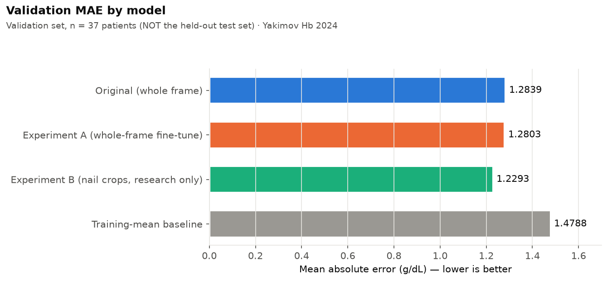
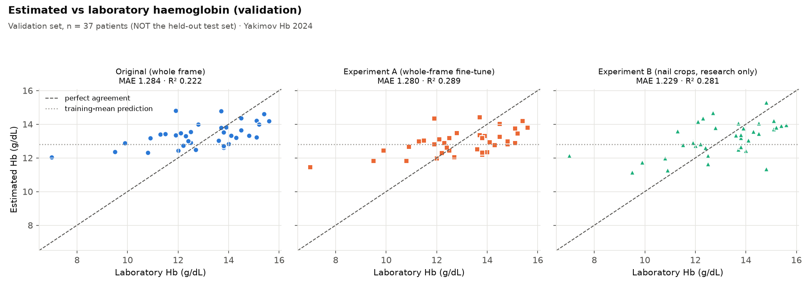
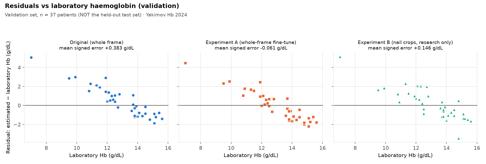

# Yakimov Hb 2024 — nail-bed haemoglobin regression experiments (A and B)

AyurAI Component 1 research record. **All results below are VALIDATION results (37 patients).
The 38-patient held-out test set has NOT been evaluated. Nothing here is clinically validated,
and no experimental checkpoint has been promoted into the live system.**

## Dataset

- **Yakimov Hb 2024** fingernail photographs with laboratory haemoglobin (Hb), one photo per patient,
  three annotated nails per photo (`NAIL_BOUNDING_BOXES`, stored as `[y1, x1, y2, x2]`).
- Fixed patient-level split (saved before these experiments, unchanged):

| Partition | Patients |
|---|---:|
| Train | 175 |
| Validation (used for model selection AND for these results) | 37 |
| Test (held out, untouched) | 38 |

Each patient appears in exactly one partition. Hb is normalised with the training-split mean/SD
(12.79 / 2.79 g/dL), the same values stored in the production checkpoint.

## Models compared

| Model | Input | Training |
|---|---|---|
| **Original (production)** | Whole photo padded to 224×224 | EfficientNet-B0 (ImageNet), frozen backbone, regression head only, 5 epochs |
| **Experiment A** | Whole photo (identical to production preprocessing) | From the production checkpoint; unfroze `features[7]`, `features[8]` + head; AdamW (backbone 1e-5, head 1e-4, weight decay 1e-4); BatchNorm statistics frozen; batch 16; ≤12 epochs, early stopping (patience 3) on validation MAE; seed 42; geometric augmentation only |
| **Experiment B** (research only) | Three annotated nail crops per patient | Same starting weights and training settings as A. Square crop around each nail box, 15% margin per side, kept inside the photo (no padding), resized to 224×224; crop-position/scale jitter and horizontal flip; **no colour augmentation** |
| **Training-mean baseline** | — | Predicts the training-set mean Hb for everyone |

**Patient-level aggregation (B):** the three nail predictions are averaged (in g/dL) into one
prediction per patient. Model selection and every metric below are per patient (n = 37), never per crop.

## Validation results (37 patients, g/dL)

| Model | MAE | RMSE | R² | Mean signed error |
|---|---:|---:|---:|---:|
| Original whole-frame | 1.2839 | 1.6129 | 0.222 | +0.383 |
| Experiment A (whole-frame fine-tune) | 1.2803 | 1.5417 | 0.289 | −0.061 |
| **Experiment B (nail crops)** | **1.2293** | 1.5506 | 0.281 | +0.146 |
| Training-mean baseline | 1.4788 | 1.8368 | −0.009 | −0.175 |

*(The original model's MAE was recorded as 1.2838 during training; this comparison computes 1.2839.
The 0.0001 g/dL difference is GPU floating-point variation from a different inference batch size.)*

### Paired patient-level comparison (EXPLORATORY)

Per-patient absolute-error differences, 5,000 paired bootstrap resamples of patients (seed 42).
Negative = the first model has lower error.

| Comparison | MAE difference | Exploratory 95% CI | Patients better / worse | Median per-patient difference |
|---|---:|---|---:|---:|
| B vs Original | −0.0546 | −0.316 to +0.211 | 16 / 21 | +0.081 |
| B vs A | −0.0510 | −0.293 to +0.196 | 22 / 15 | −0.127 |
| A vs Original | −0.0037 | −0.144 to +0.138 | 18 / 19 | +0.266 |

**How to read the 0.0545 g/dL improvement (B vs Original):**
- All three intervals include zero: **no difference is statistically supported** on 37 patients.
- B's lower mean error comes mostly from **fewer very large errors**, not from a broad improvement:
  B is better for only 16 of 37 patients, and for the median patient its error is slightly *higher* (+0.08 g/dL).
- The same 37 patients were used to choose A's and B's best epochs, so A's and B's validation results
  are **optimistic (selection bias)**. These intervals are exploratory, not significance tests.
- B is the best **validation-MAE** candidate; A has the best RMSE and R² by a small margin.

## Figures

| File | Content |
|---|---|
| `validation_mae_comparison.png` | MAE of the four models |
| `validation_rmse_comparison.png` | RMSE of the four models |
| `experiment_a_training_curves.png` | Experiment A loss and validation error per epoch (epoch 0 = production model) |
| `experiment_b_training_curves.png` | Experiment B loss and validation error per epoch (epoch 0 = original whole-frame weights evaluated on nail crops, a reference only) |
| `validation_actual_vs_predicted.png` | Estimated vs laboratory Hb, one panel per model |
| `validation_error_distribution.png` | Per-patient absolute errors |
| `validation_residuals.png` | Residual (estimated − laboratory Hb) vs laboratory Hb |





`validation_summary.json` holds the exact numbers above.

## Limitations

- **Validation only.** No held-out test evaluation yet; the 38 test patients remain untouched for one
  locked comparison.
- **Small validation set** (37 patients): differences of about 0.05 g/dL are within the uncertainty.
- **Regression toward the mean (all models).** Low-Hb patients are over-estimated and high-Hb patients
  under-estimated (see the residual plot). For anaemia screening, over-estimating low Hb is the
  clinically important failure direction.
- **Experiment B may be under-trained.** It reached the 12-epoch limit while still improving; training
  settings were kept identical to A so that only the input changed.
- **Research only.** B needs nail crops. The live webcam pipeline has no validated nail detector, so B
  cannot be used live. Controlled Yakimov photographs differ from AyurAI webcam captures.
- **Not clinically validated.** These are research estimates, not diagnostic measurements.
- **No production change.** The live model, its `validation_comparison.csv` and the fusion weights are
  unchanged.

## Reproduce (from the repository root)

```
python -m component1.experiments.yakimov_whole_frame_ft --train      # Experiment A
python -m component1.experiments.yakimov_nail_crop_ft --train        # Experiment B
python -m component1.experiments.yakimov_nail_crop_ft --compare      # validation comparison
python -m component1.experiments.export_yakimov_research_figures     # this folder
```

Checkpoints, per-patient prediction tables and run logs are kept outside Git under
`datasets/trained_model_artifacts/experiments/yakimov_hb_2024/`.
